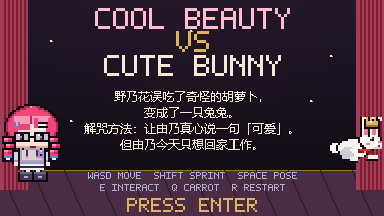
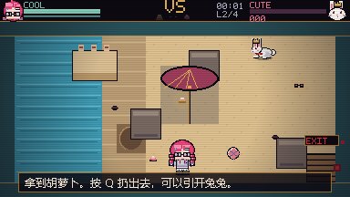
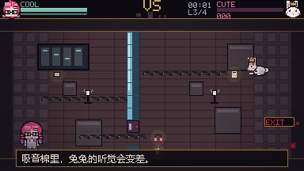
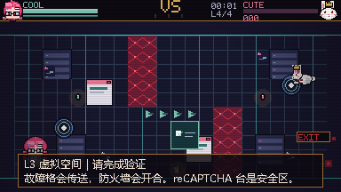

# Cool Beauty VS Cute Bunny

**野乃花变成了兔兔。由乃只想回家工作。**

A 2D pixel chase fan game starring **Sengoku Yuno** and **Miyanaga Nonoka** from
*BanG Dream! YUME∞MITA / MewType*.

Windows · Python + pygame · 4 stages · non-commercial fan game




## 这是什么

由乃只想回家工作，野乃花却误吃了奇怪的胡萝卜，变成一只银白兔兔，一路追着她跑。

玩家操作由乃，在四个单屏关卡里找齐三件东西，利用地形和道具甩开兔兔，从右侧的 **EXIT** 门离开。她越优雅，兔兔越着迷；她越跑，兔兔越兴奋。

- 单屏像素追逐，一局 3–5 分钟
- 四个关卡：化妆间 / 海滩 / 录音室 / 虚拟空间
- COOL / CUTE 双值：维持冷美人形象，还是把兔兔撩到 LOVE RUSH
- POSE、冲刺体力、扑击前摇、撞墙硬直、地形互动
- 隐藏真结局：在门口 CUTE 足够高时回头

## 下载 / 运行

### 方式 A：Releases（推荐）

前往 [Releases](https://github.com/Waters-River/Cool-Beauty-VS-Cute-Bunny/releases/latest) 下载
`CoolBeautyVS-CuteBunny-take1.zip`，解压后双击 `CoolBeautyVS CuteBunny.exe`。

### 方式 B：仓库根目录

如果 Releases 还没上传，可以直接下载仓库里的：

```text
CoolBeautyVS CuteBunny.exe
_internal/
```

**`CoolBeautyVS CuteBunny.exe` 和 `_internal` 必须放在同一层文件夹。**
只移动 exe 会打不开。

> Windows SmartScreen 可能提示“未知发布者”，选择“更多信息 → 仍要运行”。

## 操作

| 按键 | 功能 |
| --- | --- |
| WASD / 方向键 | 移动 |
| Shift | 冲刺（消耗体力） |
| 空格（按住） | 摆 POSE：回 COOL；兔兔看见会心动，但 CUTE 上升 |
| E | 互动 / 照镜子 / 关弹窗 / 出门 |
| Q | 扔胡萝卜（先捡起） |
| P | 暂停 |
| R | 重开本关 |
| F1 | CRT 扫描线开关 |
| F12 | 截图 |
| M | 静音 |
| Esc | 退出 |

## 四关

| 关卡 | 场景 | 核心地形 | 兔兔行为 |
| --- | --- | --- | --- |
| L0 | 化妆间 | 镜子、门 | 普通扑击 |
| L1 | 海滩 | 湿沙、浅水、流沙、伞影、沙滩球、潮汐 | 钻沙、怕水 |
| L2 | 录音室 | 线缆、麦克风反馈、调音台、玻璃、隔音门 | 听声定位、啃线缆 |
| L3 | 虚拟空间 | 故障格、防火墙、数据流、传送门、reCAPTCHA | 故障瞬移 |

每关找齐 3 件物品，去右侧 **EXIT** 门，按 E 或直接走进去。  
过关后按 **ENTER** 进入下一关；被抓到会立即重开本关。

## 玩法

- **COOL**：被看见、被靠近、奔跑、被扑中会掉。归零会失态硬直。
- **CUTE**：兔兔越看你越喜欢。POSE、捡东西、被扑都会加；满 100 进入 LOVE RUSH。
- **POSE**：站定回优雅，兔兔会心动；但也会让它更兴奋。
- **胡萝卜**：可以引开兔兔，但它吃完会进入 sugar rush。
- **镜子**：化妆间里可以让兔兔照镜子分心。
- **地形**：湿沙拖慢双方、浅水挡住兔兔、流沙吸脚、伞影藏人、线缆绊人、麦克风反馈晕兔、故障格传送、防火墙灼伤、reCAPTCHA 台是安全区。

## 截图

| 海滩 | 录音室 | 虚拟空间 |
| --- | --- | --- |
|  |  |  |

## 当前版本

- L0 化妆间、L1 海滩、L2 录音室、L3 虚拟空间已实装。
- 机器人由乃的最终关暂未加入；设计保留，后续再做。
- Windows 可执行版；键盘操作。
- 美术为程序生成的原创像素占位图，之后会继续替换。

## 技术栈

- Python 3.13
- pygame 2.6
- PyInstaller（Windows 可执行版）
- 384×216 原生画布，整数倍 nearest-neighbor 放大
- 程序生成的像素美术与芯片音乐

> 当前仓库以 Windows 可执行版为主；源码/开发说明暂未包含在仓库中。

## Credits

- 角色灵感：**BanG Dream! 梦限大 MewType** 的千石由乃、宫永野乃花
- 引擎：Python + pygame
- 打包：PyInstaller
- 制作：Waters-River（DSH 辅助）

本作是非商业同人 fan game，与 Bushiroad / Craft Egg 无隶属关系。  
不使用官方素材；角色版权归原权利方所有。

## License / 使用规约

本项目为非商业同人作品，**不允许直接售卖**。  
转载、二次创作请注明原仓库与作者；不要将角色素材用于商业用途。  
如需商用或正式发行，请替换为原创角色与素材。

详见 [NOTICE.md](NOTICE.md)。

## 反馈

遇到 bug、卡关或想提建议，欢迎开 [Issues](https://github.com/Waters-River/Cool-Beauty-VS-Cute-Bunny/issues)。

如果喜欢这个项目，点一个 ⭐ 就是最大的支持。